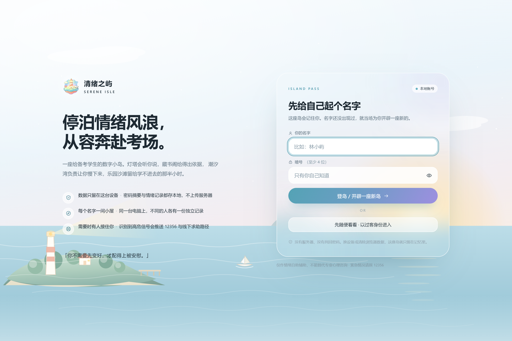
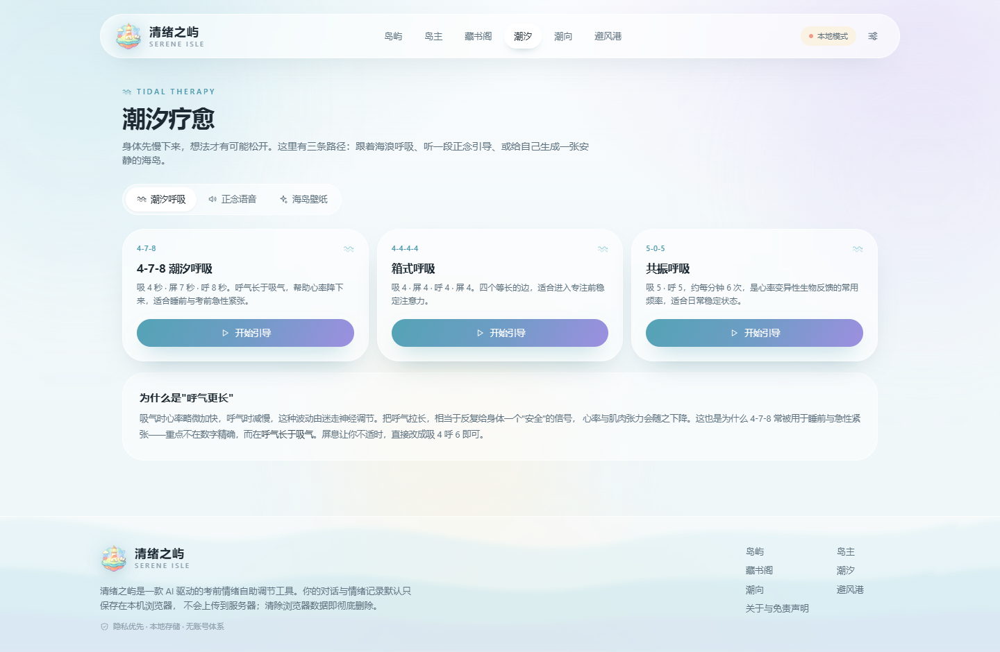
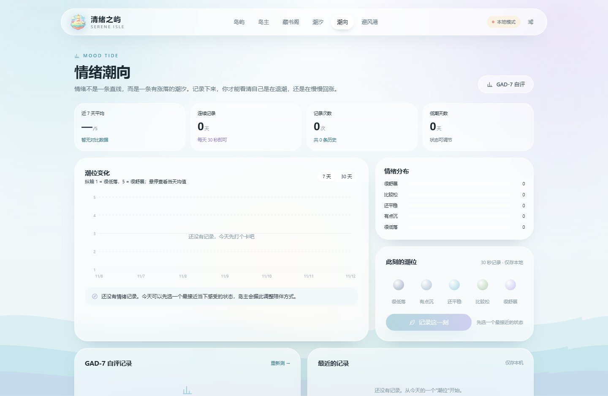
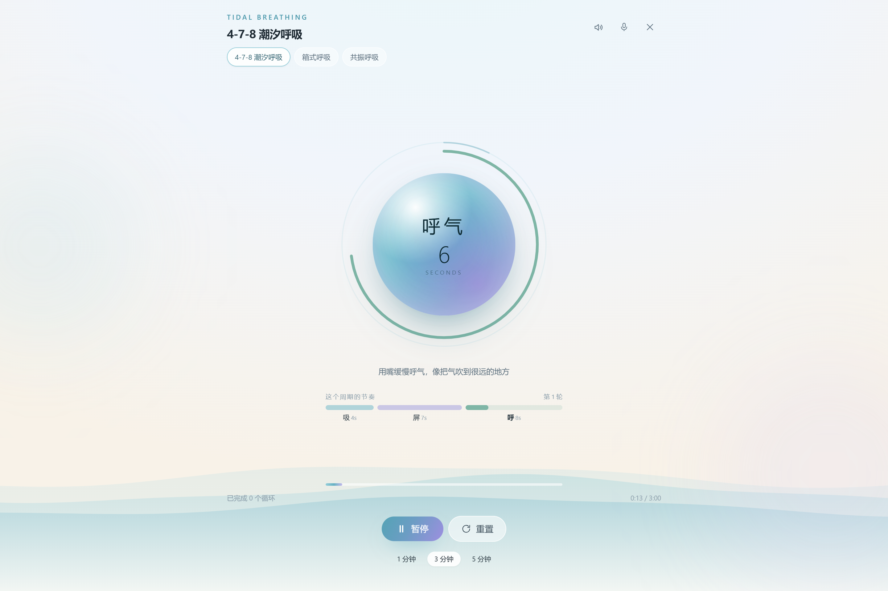

# 清绪之屿 · SereneIsle

> 考试焦虑自助调节平台 · 停泊情绪风浪，从容奔赴考场

面向高考、考研、期末考等备考人群的 **AI-Native Web 应用**。以 AI Agent 为核心，结合 RAG 心理知识库与多模态舒缓交互，提供对话疏导、情绪测评、正念放松与减压备考规划的一站式自助服务。

**隐私优先**：对话、情绪记录与自评结果默认只保存在浏览器本地，不上传服务器；「登岛」只是在这台设备上给数据分抽屉，密码同样不出本机。

> ⚠️ 本项目为心理自助辅助工具，**不能替代专业心理咨询师与医疗机构的诊断治疗**。出现严重心理困扰请及时联系线下心理卫生机构；紧急情况请拨打全国统一心理援助热线 **12356**，或 110 / 120。

---

## 界面预览

| 登岛（本地账号） | ⌘K 快捷面板 |
| --- | --- |
|  |  |

| 首页 | 岛主对话 |
| --- | --- |
|  |  |

| 潮汐疗愈 | 情绪潮向 |
| --- | --- |
|  |  |

| 分享小屋 · 书墙 | 翻开一本书，读内页与便签 |
| --- | --- |
|  |  |

| 封面设计台（像做手账） | 知识库（33 篇，篇末标依据） |
| --- | --- |
|  |  |

| 潮汐明信片（8 张手绘，导出 1920×1080） | 岛屿全景地图（可拖拽缩放） |
| --- | --- |
|  |  |

| 屿乐园 · 潮汐泡泡 | 潮汐呼吸（真实胀缩） |
| --- | --- |
|  |  |


---

## 核心功能

| 模块 | 说明 |
| --- | --- |
| **岛主对话（Agent）** | 「岛主」是情绪之屿的驻岛心理咨询师：温和稳定、专业克制，先接住情绪再梳理问题，不贴标签、不做诊断、不喊口号。模型为火山方舟豆包 `doubao-seed-2-1-turbo`，经本地代理接入，支持流式输出与 Function Calling：检索知识库、唤起呼吸引导、打开 GAD-7 自评、生成复习计划、写入情绪记录、读取情绪趋势，多轮工具循环最多 3 步，上下文只带最近 4 轮，回答控制在 260 字内。 |
| **分享小屋 · 书墙** | 一座由岛民自己写的书墙：写下心事、给封面做手账、读别人的书、在内页贴一张暖心便签。书墙按情绪类型（焦虑 / 疲惫 / 孤独 / 难过 / 迷茫 / 温暖 / 自责 / 期待）与发布时间筛选排序，可横向滑动、抽书翻开；「我的书架」存放自己写的书与收到的便签，每本书可随时在公开 / 私密之间切换。全部内容只存本地，不上传。 |
| **分享小屋 · 知识库（RAG）** | 33 篇条目、切分为 103 段检索片段，覆盖十类议题：焦虑机制、CBT 认知、CBT 工具、放松技术、睡眠、学习策略、人际与家庭、情绪与低落、身体与症状、危机识别。其中 14 篇依据四本 CBT 经典（《认知行为疗法：基础与应用》《理智胜过情感》《伯恩斯新情绪疗法》）改写，篇末标注「参考依据」。检索带话题门控，问不相关的事不会硬凑；检索到的要点只在后台作为依据融进回答，不向用户展示出处卡片。 |
| **潮汐疗愈 · 呼吸陪伴（Agent）** | 不再让用户在列表里挑节奏：先输入一句「我现在有点慌，心跳很快」，模型读成焦虑 / 紧张 / 烦躁 / 疲惫 / 失眠，再按状态配一组节奏与时长并说明理由；练习中用户说「太急了 / 跟不上 / 有点头晕」，节奏当场重算（拉长呼气、砍屏息、降时长、换 3-4-6），不是一句安慰；练完生成情绪报告（状态 / 呼吸法 / 时长 / 节奏特点 / 建议）与一张可保存的竖版明信片。所有练习写进本地「呼吸档案」，下次进来先提你上次那组。画面本身仍是随呼吸胀缩的球体、Canvas 海面涨落、按真实时长分段的节奏条；另附 8 张手绘明信片，可题字并导出 1920×1080。 |
| **情绪潮向 · 情绪画像** | 把统计表换成一张「形状」：稳定度 / 恢复力 / 记录习惯 / 压力感 / 身体感 / 自我照顾六维雷达，配上类型名（稳定回涨型、压力聚集型、身体先知道型…）与一段人话描述；点「这张画像怎么来的」可以展开数据依据，也可以让岛主用自己的话读一遍。下面只留一条 7/30 天潮位曲线与打卡，不再堆叠报表。 |
| **岛屿日记** | 每天一页随手写，可以顺手标一个此刻潮位。写完向导会读一遍并给一段针对性回应：引一句你写过的话、指出一个可能的模式、给一件今晚能做的小事。配了 Key 走模型，没配 Key 走本地规则，两种都能用。一键把当天生成一张 1080×1350 的日记卡片（Canvas 本地绘制，断网也能导），可直接保存。 |
| **屿乐园（解压小游戏）** | 四个 Canvas 小游戏：潮汐泡泡（点击爆开的粒子反馈）、沙岸拾贝（刮开沙层找贝壳与寄语）、打水漂（拖动定方向 → 长按蓄力 → 松手投出，入射角与速度决定弹跳次数，每投都带一点风与摩擦的随机）、星光许愿（在夜空点亮一颗星并写下一句话）。全部本地运行，音效由 WebAudio 实时合成，玩完可一键把当下情绪写入潮向。 |
| **登岛（本地账号）** | 一页式登录 / 注册：输入名字与暗号，名字不存在就当场开辟一座新岛；同一浏览器支持多位岛主，每人一份独立命名空间的数据；也提供"过客"入口。密码只做 SHA-256 加盐摘要后存本地，不上传。 |
| **⌘K 快捷面板** | 键盘优先的全局入口：搜索地点、开始呼吸、打开量表、切换岛屿时刻，↑↓ 选择 / Enter 执行。 |
| **避风港（危机干预）** | 关键词分级识别（输入与模型输出双通道），命中即置顶求助卡片；提供 12356（24h）、北京心理危机干预中心、120/110、校内心理中心等真实渠道。「现在这一刻」用两个问题（最难受的是哪部分 / 身边有没有人）换一张 10 分钟可勾选清单与一键动作；「不知道怎么说？我帮你写」按对象（朋友 / 家人 / 辅导员 / 医生）和程度生成可直接复制的话术；长文本（危险就在眼前、何时该就医）收进折叠块。 |

### 交互与视觉

- **岛屿全景图**：首页不再是一排跳转卡片，而是一张可点选的岛屿鸟瞰图。六处地点各有独立内容，点一下先在右侧展开"这里有什么"，再决定要不要进去。
- **随时回岛**：从地图进入的每个副页面，顶部都有一枚"回到岛屿地图 / BACK TO ATLAS"胶囊，长页面滚到底还有一张收尾卡；回来时会自动停在你上一次看的那处地点，不用重新在地图上找。页头右上角配了页码与面包屑（如 `IV —— 岛屿 ∕ Repository · RAG`），像翻阅一本图鉴。
- **地图相机**：拖拽平移、⌘/Ctrl + 滚轮缩放、双击复位、按钮微调，带惯性插值与边界约束；注记用 HTML 排版并做反缩放，放大后字号不跟着变大。整个 SVG 只在切换地点或时刻时重建，悬停走纯 CSS，不再触发整棵树重渲染。
- **岛屿时刻**：清晨 / 正午 / 黄昏 / 夜航四套天空色相，一键切换全站氛围（只换色相不压暗，保证正文对比度）。
- **海萤粒子场**：Canvas 绘制的上浮光点，指针靠近会被轻轻推开并变亮，点击生成涟漪。
- **会呼吸的海面**：登岛页的水纹不是一张静态图——每一层都在「上下起伏 + 横向流动」两个动画里叠着走，近处的浪快、远处的浪慢；鼠标划过水面会浮起一小片暖光，点一下荡开三圈涟漪并落一声很轻的水音。
- **雾岸轻音**：全站背景乐（《雾岸轻音》，取自同名短片音轨，已做响度归一）。进站尝试自动播放，被浏览器拦下时先静音待命、等你第一次点击或按键再淡入；右下角常驻开关，播放时有律动条与一圈呼吸光，悬停展开曲名与 `M` 快捷键，选择记在本地。切到别的标签页会自动停，回来接着放；打开呼吸引导时自动把音量压到 12%，不抢节奏。
- **书墙与阅读器**：书脊朝外立在木架上，一排五到六本，滑动时带吸附；悬停整本轻轻抬起、放大 4%、阴影加深，下面那行小字会换成这本书的情绪注脚。翻开时书本从底部弹起（spring + 轻微 rotateX），左边是封面与藏书印，右边是纸色内页；别人的回复是带胶带的便签，贴得歪一点，颜色随机。
- **封面设计台**：右边改、左边立刻变——九种底色、四种纸纹、四种字体、二十枚贴纸与手绘（十二种亮色笔 + 三档笔触）。贴纸落点会自动避开题字与已有贴纸，可以拖着走、双击拿掉；手绘支持笔色与三档笔触、撤销、全部擦掉。移动端把预览吸在顶部、操作吸在底部，改参数时始终看得见封面。
- **微交互**：滚动进度、路由入场、卡片 3D 倾斜与眩光、渐变描边玻璃、书脊抽书、日历热力图悬停。

### 免 Key 也能演示

未配置 API Key 时，应用自动进入 **本地知识模式**：仍会检索知识库，并按"话题 + 情绪"组合出回应，逐字流式输出，界面标注"本地知识模式"。这意味着：

- 评委可以零配置打开即体验完整流程；
- 断网 / 接口故障时不会变成白屏，而是优雅降级。

---

## 技术架构

```
┌──────────────────────────── 浏览器（不含任何密钥） ──────────────────────────┐
│                                                                              │
│  React 18 + TypeScript + Vite                                                │
│  ├─ 路由（懒加载分包）：首页 / 岛主 / 分享小屋 / 潮汐 / 潮向 / 避风港        │
│  ├─ 状态：Zustand 单 store + localStorage 持久化                              │
│  ├─ 视觉：Tailwind CSS 设计令牌 + Framer Motion                               │
│  │                                                                           │
│  ├─ lib/agent.ts       Agent 编排：规划 → 检索 → 工具循环 → 生成 → 校验      │
│  ├─ lib/llm.ts         OpenAI 兼容客户端：SSE 解析、tool_calls 增量拼装        │
│  ├─ lib/ai.ts          服务端 AI 状态与额度（/api/health）                     │
│  ├─ lib/tools.ts       7 个工具：JSON Schema + 参数校验 + 执行 + 待确认动作    │
│  ├─ lib/guard.ts       安全层：意图分类、输出审查（诊断/剂量/泄漏）、接地度    │
│  ├─ lib/mcp.ts         MCP 客户端：工具发现与调用（经 proxy 桥接）             │
│  ├─ lib/vision.ts      图片本地压缩（768/320 两档）→ 多模态输入                │
│  ├─ lib/rag.ts         切块 / BM25 召回 / 交叉重排 / 同义扩展 / 引用片段       │
│  ├─ lib/knowledge.ts   私有知识库语料                                         │
│  ├─ lib/books.ts       书墙数据层：情绪 / 封面配置 / 种子书 / 本地持久化        │
│  ├─ lib/crisis.ts      三级风险规则 + 资源清单 + 安全协议提示                 │
│  ├─ lib/tts.ts        岛主之声：云端神经语音 + 浏览器 TTS 三级降级 / 语音输入  │
│  ├─ lib/postcards.ts   明信片素材清单（8 张手绘 + 题字文案）                   │
│  └─ lib/relief.ts      避风港「七件小事」盲盒内容                              │
│                                                                              │
└───────────────────────────────┬──────────────────────────────────────────────┘
                                │ POST /api/chat/completions（同源，无密钥）
                                ▼
┌──────────────────── server/proxy.mjs（Node 内置模块） ──────────────────────┐
│  读取 .env.local 里的 ARK_API_KEY → 注入 Authorization                        │
│  关闭深度思考 · 限制 max_tokens · 限制上下文 · 每分钟限流 · token 账本熔断     │
│  /api/mcp/{tools,call}：可选的外部 MCP Server 桥接（JSON-RPC over HTTP）      │
└───────────────────────────────┬──────────────────────────────────────────────┘
                                │ HTTPS（官方开放 API）
                                ▼
                 火山方舟 doubao-seed-2-1-turbo（OpenAI 兼容）
                 也可切换为 DeepSeek / 智谱 / 通义 / Ollama
```

### 为什么密钥不放在前端

`VITE_` 前缀的变量会被打进 JS 产物，任何访问者打开 DevTools 都能看到。因此本项目默认走**本地 Node 代理**：密钥只在服务端进程的环境变量里，浏览器只知道"能不能用、还剩多少额度"。这既满足比赛对密钥存放的硬性要求，也让前端换模型不需要重新打包。

### AI 链路的五个层次

整条链路是一个**有边界的工作流**，不是"把用户的话转发给模型"：每次回答都会先规划、再决定要不要检索、按需调用工具、最后过一遍安全校验。这条链路的每一步都会写进消息的 `plan` / `trace` / `guard` 字段（「理解 → 检索 → 工具 → 校验」四类事件），既用于本地排障，也方便在开发者工具里复核；界面上不打扰用户，只保留「朗读」这一个出口。

```
理解意图 + 风险分级 ─→ 检索决策（RAG）─→ Agent 工具循环 ─→ 流式生成 ─→ 输出安全审查
      ↑ 本地规则          ↑ 两阶段检索       ↑ ≤3 步           ↑ SSE      ↑ 命中就地改写
```

#### 1. 规划（lib/agent.ts · 零成本）

一句话进来，先用本地规则判断四件事：**意图**（危机 / 焦虑 / 睡眠 / 学业 / 人际 / 寒暄）、**风险等级**（三级）、**要不要检索**（寒暄不检索，省一次上下文重发）、**本次允许几步工具**。工具预算会跟着额度走——已用超过 85% 时只给 1 步、超过 60% 给 2 步，把"省着用"写进了调度而不是靠人自觉。

#### 2. 检索增强（lib/rag.ts · 两阶段）

- **召回**：中文「单字 + 二元组」分词，50+ 组同义扩展（睡不着 → 失眠/睡眠），BM25（k1=1.45, b=0.72）打分，取前 8 段；
- **重排**：`0.55 × 归一化 BM25 + 0.35 × 查询覆盖率 + 0.10 × 标题命中`，再做"同一篇只留一段"的多样性去重，最后按相对阈值截断；
- **门控**：没有话题锚点、二元组命中也少时直接返回空。宁可说"没查到"，也不把无关段落塞给模型；
- **接地度**：回答生成后算它和检索片段的二元组重合度（0–1），写进消息的 `guard.grounded`（"参考资料覆盖 42%"）。引用不外露，但"有没有真的用上资料"是可查的。

#### 3. Agent 工具循环（lib/tools.ts · Function Calling）

工具是**注册表**而不是 if-else：每个工具声明 `name / description / parameters(JSON Schema) / run`，编译成 OpenAI 兼容的 tools 数组。执行前按 Schema 校验参数（必填、类型、枚举、上下界），不合法就回一条结构化错误——模型看到错误可以自己改参数重试，而不是让整段回答崩掉。循环最多 3 步，工具结果不再让它念给用户听。

#### 4. 多模态（lib/vision.ts + lib/tts.ts）

- **图片进**：选图后在浏览器本地压到长边 768（送模型）与 320（存缩略图），视觉 token 按面积计费，压缩直接决定了这条消息贵不贵。图片只随本次请求发送，不进历史，避免每轮重复计费；
- **语音进**：Web Speech Recognition，说话直接变成输入框里的文字；
- **语音出**：每条回答都能点「朗读」，沿用设置里的音色与语速，逐句合成、可中断。

#### 5. 安全与可控（lib/guard.ts · 本地规则，不额外计费）

- **输入端**：三级风险规则 + 意图分类，高危时收紧人设、缩短篇幅、强制给出求助渠道；
- **生成端**：system prompt 里写死"不诊断、不承诺、不替代真人"；
- **输出端**：落库前逐条过审查——诊断性断言、医疗承诺、药物剂量、身份越界、工具名/JSON 泄漏、"已经帮你打开了"这类谎称，命中就地改写；危机场景没给出口就补一句。审查了几项、改了什么，直接显示在「校验」那一行；
- **兜底**：模型报错 → 本地知识模式（规则 + 检索 + 组合式回应），额度耗尽 → 立即停止云端调用并如实告知，绝不偷偷重试。

### 工具清单（Function Calling）

| 工具 | 触发场景 | 副作用 |
| --- | --- | --- |
| `search_knowledge_base` | 问"为什么/怎么办/有依据吗" | 返回 2 条精简要点，作为依据注入下一轮上下文 |
| `start_breathing` | 心慌、手抖、坐不住、睡不着 | 打开呼吸引导面板并选中节奏 |
| `open_anxiety_assessment` | 想知道焦虑程度、症状持续两周 | 打开 GAD-7 量表 |
| `create_study_plan` | 时间不够、要复习安排 | 生成分阶段、含放松时段的计划 |
| `log_mood` | 用户确认分数后 | 写入本地情绪记录 |
| `get_mood_trend` | 想回顾最近状态 | 读取并统计近 N 天数据 |
| `navigate_to` | 想动手做点什么 | 提议前往潮汐 / 藏书阁 / 避风港 / 潮向，用户确认后才跳转 |

所有会改动界面或本地数据的工具都只产出「待确认动作」，绝不自己执行；参数在执行前按 JSON Schema 校验，不合法回结构化错误让模型自我修正。

### MCP：把外部工具接进来

除内置工具外，代理还实现了 **MCP（Model Context Protocol）桥接**，可以挂载任意支持 Streamable HTTP 传输的 MCP Server：

```bash
# .env.local（可选，不填就只用内置工具）
MCP_SERVERS=http://127.0.0.1:8791/mcp,https://example.com/mcp
```

- 启动时对每个 Server 走 `initialize → notifications/initialized → tools/list` 握手，结果缓存 60 秒；
- 前端把外部工具命名空间化为 `mcp__<server>__<tool>`，与内置工具一起交给模型，模型无需区分来源；
- 调用时前端 → `/api/mcp/call` → 代理 → `tools/call`，返回的文本作为工具结果回填上下文；
- 没配置时两个接口都返回空列表，链路完全不受影响。

仓库里带了一个可跑的 mock Server（`scripts/qa/mcp-mock.mjs`），用于验证握手与调用：

```bash
node scripts/qa/mcp-mock.mjs 8791
MCP_SERVERS=http://127.0.0.1:8791/mcp node server/proxy.mjs
curl http://127.0.0.1:8787/api/mcp/tools
```

### 岛主之声：朗读不只用系统音

Windows 自带的 `speechSynthesis` 只有 Huihui / Yaoyao 这类十几年前的老音色，念正念引导时机械感很重。所以项目自己接了一套神经语音：

- **音色**：与 Edge「大声朗读」同一套（默认 `zh-CN-XiaoxiaoNeural`，另有晓伊 / 云希 / 云健），中文的自然度和停顿接近真人，可放缓到 0.6× 而不失真；
- **实现**：`server/edge-tts.mjs`，只用 Node 内置模块 —— `WebSocket` 说微软的语音协议，`crypto` 复刻了它要求的 `Sec-MS-GEC` 签名（SHA-256 变体 + CS64 摘要，每 5 分钟按时间戳重新生成一次）；
- **缓存**：同一句话只合成一次，落在 `server/.tts-cache/`（已 gitignore）。正念脚本、盲盒内容这类固定文本，第二次播放是零延迟；
- **降级**：云端 → 浏览器内置语音 → 只显示文字。三级兜底保证「点了总有反应」，`/api/tts` 不可用时会自动切到系统音色并在 5 分钟内不再重试；
- **落点**：岛主每条回答下的「朗读」、欢迎页的「听听我的声音」（`public/voice/greeting.mp3`）、潮汐页的正念语音、避风港盲盒的「听岛主念一遍」。

声音设置集中在「岛屿设置 → 岛主之声」，改音色或语速会即时生效，旁边有「试听」可以直接对比。

> 合成需要联网（文本会在本次请求中发往语音服务，不做留存）；纯静态部署没有代理，会自动退回系统语音，功能不缺失。

### 呼吸陪伴：从「状态」到「报告」的闭环

潮汐页原来是一个节奏列表：三种呼吸法摆在那里，用户自己挑。现在改成一条完整的链路，页面里只有一句话的入口。

```
说一句 → 读状态 → 配节奏 → 练（可随时改）→ 写报告 → 记进档案
```

**1. 状态识别：模型理解，规则决策**

模型只负责「听懂」：把「我刚吵完架，胸口闷」读成 `烦躁`，并给一句不超过 40 字的回应。把状态映射成哪组节奏、练多久、用户说「头晕」时怎么改，全部由 `src/lib/breath.ts` 的规则算——这样做有三个好处：断网可用、结果可解释、评审可以追问每一步。

| 状态 | 典型信号 | 推荐节奏 | 时长 | 为什么 |
| --- | --- | --- | --- | --- |
| 焦虑 | 心慌、心跳快、发抖 | 4-4-8 长呼 | 3 分钟 | 呼气是吸气的两倍，心率下降最快；屏息只留 4 秒，因为憋气会让心慌的人更慌 |
| 紧张 | 明天考试、静不下来 | 4-7-8 潮汐 | 3 分钟 | 屏息段把注意力从「未来」拉回身体 |
| 烦躁 | 生气、胸口闷 | 4-2-6 缓降 | 2 分钟 | 只留 2 秒过渡，重点在「叹出去」的 6 秒 |
| 疲惫 | 累、空、提不起 | 4-6 轻呼吸 | 2 分钟 | 不屏息、不深呼吸，只把呼气稍微延长 |
| 失眠 | 躺下后脑子停不下来 | 4-7-8 睡前版 | 5 分钟 | 呼吸频率压到接近每分钟 6 次 |
| 说不清 | 信息不足 | 3-4-6 温和 | 2 分钟 | 最不容易出错的节奏，先跟上再说 |

模型不可用（超时 9 秒 / 代理没起 / 返回格式错）时，自动退回本地关键词识别，页面顶部会标「本地规则」，功能一个不少。

**2. 实时反馈：说一句，改一处**

练习界面下方有四个按钮，不需要退出重来：

| 用户说 | 系统做什么 |
| --- | --- |
| 太急了（第一次） | 呼气 +1 秒；有屏息则砍掉 2 秒 |
| 太急了（连续第二次） | 直接切 3-4-6 柔和模式：不屏息、呼气 6 秒，时长收到「已练时间 + 90 秒」 |
| 跟不上 | 整组缩短（吸 -1 / 屏 -2 / 呼 -1，下限 3-4） |
| 有点头晕 | 取消全部屏息、不深吸，同时给出过度换气的安全提示，并把这个标记写进档案 |
| 继续保持 | 不改节奏，只确认 |

换节奏时相位从「吸气」重新开始（记录一个相位偏移量），不会在半口气上跳变。

**3. 报告与档案**

练完生成一份报告：本次状态、使用呼吸法、实际时长、完成循环、节奏特点、三条建议，外加一张 1080×1320 的竖版明信片（Canvas 本地绘制，可直接保存）。中途退出只要练过 15 秒也会生成，标记为「提前结束」——停下来也算一次。

每次练习写入 `breath-sessions`（只存时间、状态、节奏、时长、反馈，不存聊天原文）。档案会算出：常用节奏、平均时长、连续天数、是否怕屏息、偏好节奏；下次进入时，岛主先开口：

> 你上次练完说有点头晕，这次我就不给你排屏息了——直接走柔和模式。

**4. 回归脚本**

```bash
npm run demo                                    # 或 npm run dev
node scripts/qa/breath-companion.mjs            # 12 项断言：断网降级 / 改节奏 / 报告 / 画像 / 向导
```

脚本会主动断掉模型请求，先验证「本地规则」这条路能走完整流程，再验证界面上的每个结论。

**5. 隐私**

状态识别的那句话只在本次请求里发给模型，不落库；练习记录全部在本机。清空档案在档案卡底部，点两次确认。

---

## 快速开始

环境要求：Node.js ≥ 20（内置 WebSocket 要用它做语音合成），npm ≥ 9。

```bash
# 0. 克隆仓库
git clone https://github.com/Jcaser/Isle-of-Moods.git
cd Isle-of-Moods

# 1. 安装依赖
npm install

# 2. 配置密钥（只写在本机，不会进 Git）
cp .env.example .env.local      # Windows: copy .env.example .env.local
# 打开 .env.local，填 ARK_API_KEY=...

# 3. 一条命令同时起代理与前端
npm run dev                     # http://127.0.0.1:5173

# 4. 生产构建 + 单端口演示（页面与 API 都在 8787）
npm run demo
```

### 环境变量模板

完整模板见 [`.env.example`](.env.example)。`.env.local` 已在 `.gitignore` 中，不会进入仓库。

| 变量 | 必填 | 说明 |
| --- | --- | --- |
| `ARK_API_KEY` | 是 | 火山方舟 API Key（仅服务端读取） |
| `ARK_MODEL` | 是 | 已开通的模型 ID，如 `doubao-seed-2-1-turbo-260628` |
| `ARK_BASE_URL` | 否 | 默认 `https://ark.cn-beijing.volces.com/api/v3` |
| `ARK_TOKEN_BUDGET` | 否 | 自设 token 上限，默认 300000，触达即停 |
| `ARK_MAX_OUTPUT_TOKENS` | 否 | 单次输出上限，默认 700 |
| `ARK_RATE_LIMIT` | 否 | 每分钟请求上限，默认 20 |
| `PROXY_PORT` | 否 | 本地代理端口，默认 8787 |

> 没有密钥也能跑：应用会自动进入「本地知识模式」，检索 + 规则化共情模板，界面功能完整。

### 依赖清单

`npm install` 会按 `package.json` 装齐，无需全局安装任何工具；版本以 `package.json` / `package-lock.json` 为准。

| 类别 | 依赖 | 用途 |
| --- | --- | --- |
| 运行时 | `react` / `react-dom` 18 | 视图层 |
| 运行时 | `react-router-dom` 6 | 路由（按页懒加载分包） |
| 运行时 | `zustand` 5 | 单一状态源 + localStorage 持久化 |
| 运行时 | `framer-motion` 11 | 页面转场、呼吸环形、弹层动效 |
| 运行时 | `react-markdown` + `remark-gfm` | 岛主回答的 Markdown 渲染 |
| 运行时 | `clsx` | 条件类名拼装 |
| 开发 | `vite` 5 + `@vitejs/plugin-react` | 开发服务器与生产构建 |
| 开发 | `typescript` 5.6 | 全量类型检查（`npm run typecheck`） |
| 开发 | `tailwindcss` 3 + `postcss` + `autoprefixer` | 设计令牌与工具类 |
| 开发 | `@types/react` / `@types/react-dom` | 类型声明 |

> 服务端零第三方依赖：`server/proxy.mjs` 只用 Node 内置模块（`http` / `https` / `fs` / 全局 `WebSocket`），因此 Node ≥ 20 是硬性要求，也不需要为语音合成额外装包。

---

## 部署

纯静态产物（`dist/`），任意静态托管均可：

| 平台 | 做法 |
| --- | --- |
| Vercel | 导入仓库，Framework 选 Vite，已内置 `vercel.json` 的 SPA rewrite |
| Netlify | Build command `npm run build`，Publish `dist`，已内置 `public/_redirects` |
| GitHub Pages | 需在 `vite.config.ts` 设置 `base`，并将路由改为 HashRouter；或用 404.html 兜底 |
| 自有服务器 | Nginx 托管 `dist`，`try_files $uri $uri/ /index.html;` |

> ⚠️ **纯静态托管没有代理层**，`/api` 不存在，页面会退回本地知识模式（功能仍完整可用）。
> 需要线上也能对话时，把 `server/proxy.mjs` 部署到任意支持 Node 的服务，或直接用 `npm run demo` 在本机单端口演示（比赛评审推荐这种方式）。

---

## 隐私与数据

- 无手机号、无邮箱、无第三方统计与广告脚本；账号只用于在这台设备上给数据分抽屉；
- 密码用 SHA-256 加盐后存 `localStorage`（`sereneisle.auth.*`），没有服务端可校验，也取不回明文；
- 每位岛主的数据按命名空间隔离：`sereneisle.v1.u_<id>.mood` 等，切换账号互不可见；
- 对话、情绪记录、自评结果存于 `localStorage`（键名前缀 `sereneisle.v1.`）；
- **API Key 不在浏览器里**：默认走本地代理，密钥只存在于服务端 `.env.local`（已被 `.gitignore` 忽略），既不进 Git、也不进前端产物；只有手动切到"直连模式"时，你自己填的 Key 才会存在本机浏览器；
- 设置中可导出 JSON 备份，或一键删除全部本地数据；
- 清除浏览器站点数据即彻底删除；
- 知识库与检索全部在浏览器内完成，问题原文不会离开设备（除非你配置了云端模型）；
- 书墙里的书与便签同样只存本地（`books` / `book-replies`），设为「私密」的书只出现在自己的书架。

---

## 目录结构

```
serene-isle/
├─ public/
│  ├─ brand/                 # 抠图后的品牌图标（512/256/128/64 + favicon + 圆形头像）
│  ├─ postcards/             # 8 张手绘明信片原图（16:9 JPG）
│  ├─ gallery/               # 首页 3D 环形画廊的 7 张明信片（webp）
│  ├─ relief/                # 避风港盲盒的 7 张配图（webp）
│  ├─ voice/                 # greeting.mp3：岛主的声音名片
│  └─ _redirects             # Netlify SPA 兜底
├─ server/
│  ├─ proxy.mjs              # 本地 AI 代理：注入密钥、关闭思考、限流、token 账本熔断、托管 dist
│  └─ edge-tts.mjs           # 岛主之声：Edge 神经语音合成 + Sec-MS-GEC 签名 + 磁盘缓存
├─ scripts/
│  ├─ dev.mjs                # 一条命令同时起代理 + Vite
│  ├─ ark-models.mjs         # 查看账号可见的对话模型
│  ├─ cutout.py              # 图标抠图脚本（容差洪泛 + 最大连通域 + 形态学腐蚀）
│  └─ mock-llm.mjs           # 本地 OpenAI 兼容 Mock，用于验证流式与工具调用
├─ src/
│  ├─ components/            # Layout / IslandAtlas / RingGallery / BreathCompanion / MoodPortrait / NowWizard / ReliefBlindBox …
│  │  └─ games/              # Bubbles / ShellHunt / Skipping / StarWish（Canvas 小游戏）
│  ├─ pages/                 # Home / Chat / Library / Calm / Play / Mood / Harbor
│  ├─ lib/                   # agent / llm / tools / rag / breath / breathCoach / breathProfile / portrait / harbor / tts …
│  ├─ store/useAppStore.ts   # Zustand 单一状态源
│  ├─ index.css              # 设计令牌与组件层
│  └─ main.tsx               # 路由与全局弹层
├─ docs/
│  ├─ brand/icon-1024.png    # 图标原尺寸（用于文档/视频，不打入产物）
│  └─ screenshots/
├─ .env.example              # 环境变量模板（不含真实密钥）
└─ vite.config.ts
```

---

## 代码规范

- **语言与类型**：全量 TypeScript，`strict: true` 且开启 `noUnusedLocals` / `noUnusedParameters`；`npm run build` 会先跑 `tsc --noEmit`，类型错误进不了产物。
- **目录分层**：`pages`（路由页，只负责编排）/ `components`（可复用视图，按域细分，如 `library/`、`games/`）/ `lib`（纯逻辑：Agent、RAG、Canvas、音效、数据层）/ `store`（单一 Zustand store）。页面不直接读写 `localStorage`，统一走数据层与 store，便于替换后端。
- **命名**：组件与组件文件 PascalCase；函数、变量 camelCase；常量 UPPER_SNAKE；localStorage 键统一 `sereneisle.v1.` 前缀，并按岛主 id 做命名空间隔离。
- **注释**：每个模块顶部有一段文件级说明（负责什么、为什么这么设计）；物理常量、检索参数、正则等「魔法值」就地注明来源或调参依据；复杂交互按阶段写短注释，只解释意图，不复述代码。
- **样式**：Tailwind 工具类 + `index.css` 中的设计令牌（色板、圆角、阴影、动效关键帧），不散落行内魔法色值；逐帧动画走 CSS 变量与 rAF，避免每帧触发 React 重渲染。
- **可访问性**：可点元素带 `aria-label`，弹层有 `role="dialog"` 与 Esc 关闭，键盘可完成主要流程，并遵循 `prefers-reduced-motion`。
- **提交规范**：Conventional Commits 前缀（`feat` / `fix` / `perf` / `docs` / `test` / `chore`），一次提交只做一件事，提交信息写清动机。

---

## 知识库的来源与边界

`src/lib/knowledge.ts` 里的 33 篇条目全部是**项目自建的中文科普文本**，没有收录任何图书原文。其中 14 篇的方法框架来自四本认知行为疗法（CBT）经典 —— 其中《伯恩斯新情绪疗法》与 Feeling Good 是同一本书的中文版与英文原版，内容不重复计入：

| 书目 | 作者 / 译者 | 本项目用到的部分 |
| --- | --- | --- |
| 《认知行为疗法：基础与应用》（原著第三版） | Judith S. Beck 著，王建平等译，中国轻工业出版社 | 认知概念化、活动安排、结构化会谈、评估与回应自动思维、意象技术 |
| 《理智胜过情感》（Mind Over Mood） | Greenberger & Padesky 著，张忆家译，中国轻工业出版社 | 七栏思维记录表、证据检验、平衡思维、行为试验、箭头向下、核心信念、活动记录、焦虑与惊恐、愤怒剖析图、责任分布图 |
| 《伯恩斯新情绪疗法》（Feeling Good） | David Burns 著 | 十种认知扭曲、三栏法、愤怒与内疚的处理 |

> 以上三行对应收到的四本书；第三行为《伯恩斯新情绪疗法》与 Feeling Good 的合并项（同一本书的中译与英文原版）。

处理原则：

- **只取方法框架，不搬原文**。每篇都是按中文语境、面向学生重写的说明，长度控制在 400–700 字，便于按段落切分检索；
- **标注可回溯**。带出处的条目在 `sources` 字段里写明书名与章节，知识库阅读页底部显示「参考依据」；对话界面不展示出处，保持聊天本身干净；
- **注明边界**。所有内容不构成诊疗建议，涉及自伤、进食障碍、惊恐发作等议题时，条目内会明确提示就医与求助渠道。

上述图书版权归原作者与出版方所有。如权利人认为某处表述不妥，可联系删除对应条目。
---

## 已知限制

- GAD-7 为筛查量表，分数变化仅用于自我观察，不构成诊断；
- 本地 BM25 检索在语义泛化上弱于向量检索，长尾表达可能召回不足（已用同义扩展缓解）；
- 语音合成依赖联网：走代理时用神经语音（晓晓等），纯静态部署退回系统语音包，不同设备音色会不一样；
- 图片理解要所选模型支持视觉输入（本项目使用的 doubao-seed 系列支持），换模型时需自行确认；
- 本地模式为规则模板，不具备开放式对话能力，仅用于兜底演示；
- MCP 桥接实现的是工具发现与调用（tools/list、tools/call），暂不支持 resources / prompts 与 stdio 传输。

## 团队

| 项 | 内容 |
| --- | --- |
| 参赛赛道 | AI 健康与生活服务 |
| 所在学校 | 重庆科技大学 |
| 参赛队名 | 别的都不对 |

## License

MIT，详见 [LICENSE](LICENSE)。
