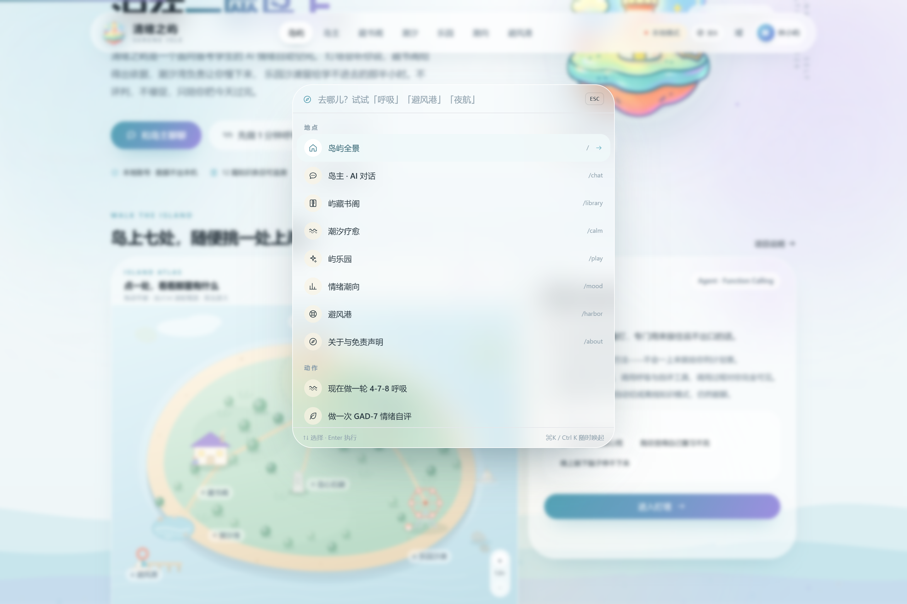
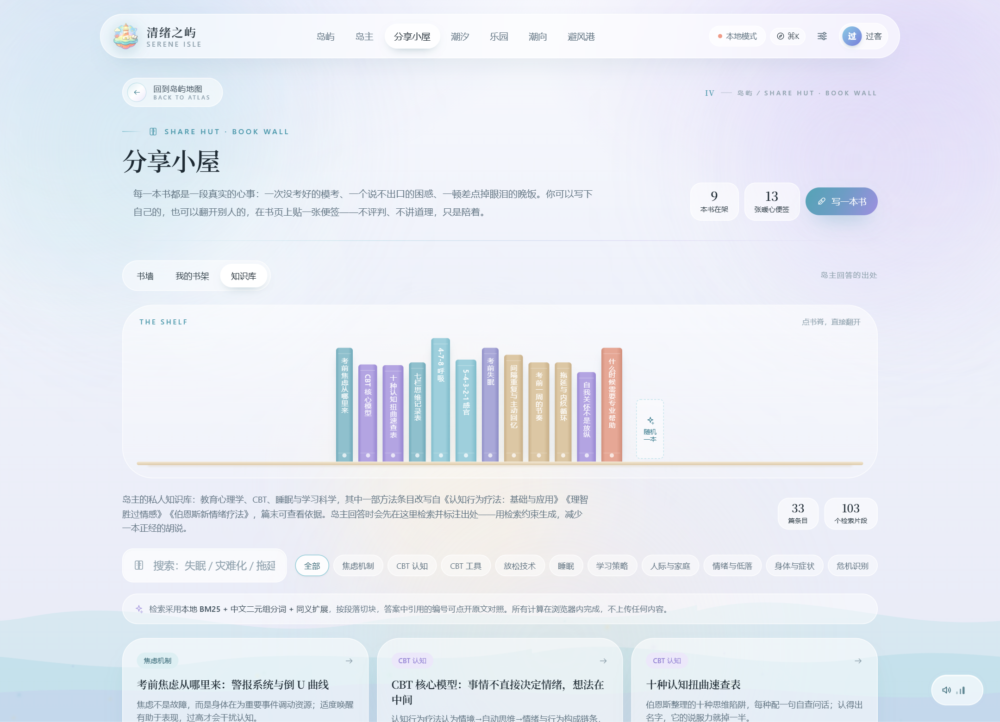
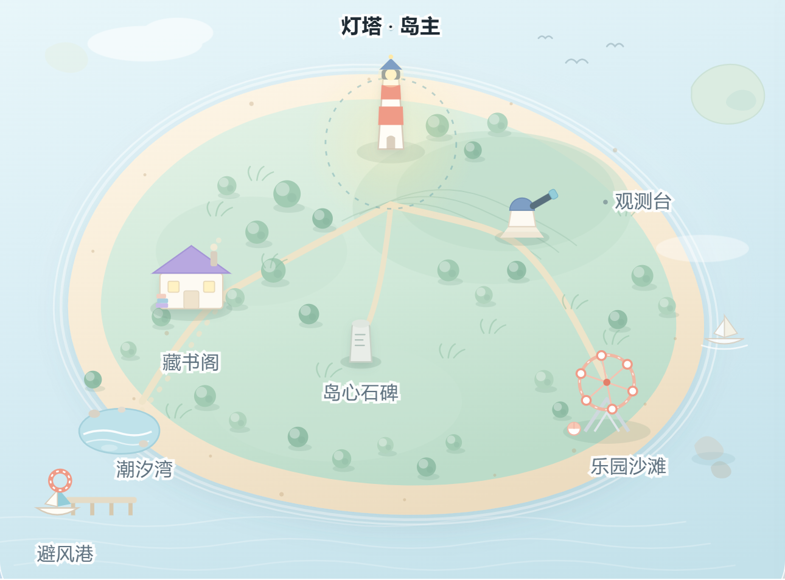
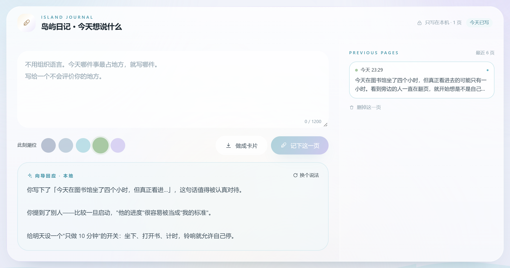

# 清绪之屿 · SereneIsle

> 考试焦虑自助调节平台 · 停泊情绪风浪，从容奔赴考场

面向高考、考研、期末考等备考人群的 **AI-Native Web 应用**。以 AI Agent 为核心，结合 RAG 心理知识库与多模态舒缓交互，提供对话疏导、情绪测评、正念放松与减压备考规划的一站式自助服务。

**隐私优先**：对话、情绪记录与自评结果默认只保存在浏览器本地，不上传服务器；「登岛」只是在这台设备上给数据分抽屉，密码同样不出本机。

> ⚠️ 本项目为心理自助辅助工具，**不能替代专业心理咨询师与医疗机构的诊断治疗**。出现严重心理困扰请及时联系线下心理卫生机构；紧急情况请拨打全国统一心理援助热线 **12356**，或 110 / 120。

---

## 界面预览

| 登岛（本地账号） | ⌘K 快捷面板 |
| --- | --- |
|  |  |

| 首页 | 岛主对话 |
| --- | --- |
|  |  |

| 潮汐疗愈 | 情绪潮向 |
| --- | --- |
|  |  |

| 分享小屋 · 书墙 | 翻开一本书，读内页与便签 |
| --- | --- |
|  |  |

| 封面设计台（像做手账） | 知识库（33 篇，篇末标依据） |
| --- | --- |
|  |  |

| 端侧生成壁纸 | 岛屿全景地图（可拖拽缩放） |
| --- | --- |
|  |  |

| 屿乐园 · 潮汐泡泡 | 潮汐呼吸（真实胀缩） |
| --- | --- |
|  |  |



---

## 核心功能

| 模块 | 说明 |
| --- | --- |
| **岛主对话（Agent）** | 「岛主」是情绪之屿的驻岛心理咨询师：温和稳定、专业克制，先接住情绪再梳理问题，不贴标签、不做诊断、不喊口号。模型为火山方舟豆包 `doubao-seed-2-1-turbo`，经本地代理接入，支持流式输出与 Function Calling：检索知识库、唤起呼吸引导、打开 GAD-7 自评、生成复习计划、写入情绪记录、读取情绪趋势，多轮工具循环最多 3 步，上下文只带最近 4 轮，回答控制在 260 字内。 |
| **分享小屋 · 书墙** | 一座由岛民自己写的书墙：写下心事、给封面做手账、读别人的书、在内页贴一张暖心便签。书墙按情绪类型（焦虑 / 疲惫 / 孤独 / 难过 / 迷茫 / 温暖 / 自责 / 期待）与发布时间筛选排序，可横向滑动、抽书翻开；「我的书架」存放自己写的书与收到的便签，每本书可随时在公开 / 私密之间切换。全部内容只存本地，不上传。 |
| **分享小屋 · 知识库（RAG）** | 33 篇条目、切分为 103 段检索片段，覆盖十类议题：焦虑机制、CBT 认知、CBT 工具、放松技术、睡眠、学习策略、人际与家庭、情绪与低落、身体与症状、危机识别。其中 14 篇依据四本 CBT 经典（《认知行为疗法：基础与应用》《理智胜过情感》《伯恩斯新情绪疗法》）改写，篇末标注「参考依据」。检索带话题门控，问不相关的事不会硬凑；检索到的要点只在后台作为依据融进回答，不向用户展示出处卡片。 |
| **潮汐疗愈（多模态）** | 4-7-8 / 箱式 / 共振三种呼吸节奏：球体随呼吸真实胀缩（吸满 → 屏息微胀 → 呼气回落到最小），相位弧一圈圈用掉，Canvas 海面随潮位涨落，底部节奏条按"吸 / 屏 / 呼"的真实时长分段推进；另有提示音与中文语音引导、Web Speech API 正念语音、Canvas 程序化生成 1080×1440 海岛壁纸并导出 PNG。 |
| **情绪潮向** | 30 秒情绪打卡（1–5 分 + 影响因素标签 + 备注）、7/30 天趋势图、情绪分布、连续记录天数、洞察提示、GAD-7 自评历史。 |
| **岛屿日记** | 每天一页随手写，可以顺手标一个此刻潮位。写完向导会读一遍并给一段针对性回应：引一句你写过的话、指出一个可能的模式、给一件今晚能做的小事。配了 Key 走模型，没配 Key 走本地规则，两种都能用。一键把当天生成一张 1080×1350 的日记卡片（Canvas 本地绘制，断网也能导），可直接保存。 |
| **屿乐园（解压小游戏）** | 四个 Canvas 小游戏：潮汐泡泡（点击爆开的粒子反馈）、沙岸拾贝（刮开沙层找贝壳与寄语）、打水漂（拖动定方向 → 长按蓄力 → 松手投出，入射角与速度决定弹跳次数，每投都带一点风与摩擦的随机）、星光许愿（在夜空点亮一颗星并写下一句话）。全部本地运行，音效由 WebAudio 实时合成，玩完可一键把当下情绪写入潮向。 |
| **登岛（本地账号）** | 一页式登录 / 注册：输入名字与暗号，名字不存在就当场开辟一座新岛；同一浏览器支持多位岛主，每人一份独立命名空间的数据；也提供"过客"入口。密码只做 SHA-256 加盐摘要后存本地，不上传。 |
| **⌘K 快捷面板** | 键盘优先的全局入口：搜索地点、开始呼吸、打开量表、切换岛屿时刻，↑↓ 选择 / Enter 执行。 |
| **避风港（危机干预）** | 关键词分级识别（输入与模型输出双通道），命中即置顶求助卡片；提供 12356（24h）、北京心理危机干预中心、120/110、校内心理中心等真实渠道，并给出"此刻需要什么"的分支行动。 |

### 交互与视觉

- **岛屿全景图**：首页不再是一排跳转卡片，而是一张可点选的岛屿鸟瞰图。六处地点各有独立内容，点一下先在右侧展开"这里有什么"，再决定要不要进去。
- **随时回岛**：从地图进入的每个副页面，顶部都有一枚"回到岛屿地图 / BACK TO ATLAS"胶囊，长页面滚到底还有一张收尾卡；回来时会自动停在你上一次看的那处地点，不用重新在地图上找。页头右上角配了页码与面包屑（如 `IV —— 岛屿 ∕ Repository · RAG`），像翻阅一本图鉴。
- **地图相机**：拖拽平移、⌘/Ctrl + 滚轮缩放、双击复位、按钮微调，带惯性插值与边界约束；注记用 HTML 排版并做反缩放，放大后字号不跟着变大。整个 SVG 只在切换地点或时刻时重建，悬停走纯 CSS，不再触发整棵树重渲染。
- **岛屿时刻**：清晨 / 正午 / 黄昏 / 夜航四套天空色相，一键切换全站氛围（只换色相不压暗，保证正文对比度）。
- **海萤粒子场**：Canvas 绘制的上浮光点，指针靠近会被轻轻推开并变亮，点击生成涟漪。
- **会呼吸的海面**：登岛页的水纹不是一张静态图——每一层都在「上下起伏 + 横向流动」两个动画里叠着走，近处的浪快、远处的浪慢；鼠标划过水面会浮起一小片暖光，点一下荡开三圈涟漪并落一声很轻的水音。
- **雾岸轻音**：全站背景乐（《雾岸轻音》，取自同名短片音轨，已做响度归一）。进站尝试自动播放，被浏览器拦下时先静音待命、等你第一次点击或按键再淡入；右下角常驻开关，播放时有律动条与一圈呼吸光，悬停展开曲名与 `M` 快捷键，选择记在本地。切到别的标签页会自动停，回来接着放；打开呼吸引导时自动把音量压到 12%，不抢节奏。
- **书墙与阅读器**：书脊朝外立在木架上，一排五到六本，滑动时带吸附；悬停整本轻轻抬起、放大 4%、阴影加深，下面那行小字会换成这本书的情绪注脚。翻开时书本从底部弹起（spring + 轻微 rotateX），左边是封面与藏书印，右边是纸色内页；别人的回复是带胶带的便签，贴得歪一点，颜色随机。
- **封面设计台**：右边改、左边立刻变——九种底色、四种纸纹、四种字体、二十枚贴纸与手绘（十二种亮色笔 + 三档笔触）。贴纸落点会自动避开题字与已有贴纸，可以拖着走、双击拿掉；手绘支持笔色与三档笔触、撤销、全部擦掉。移动端把预览吸在顶部、操作吸在底部，改参数时始终看得见封面。
- **微交互**：滚动进度、路由入场、卡片 3D 倾斜与眩光、渐变描边玻璃、书脊抽书、日历热力图悬停。

### 免 Key 也能演示

未配置 API Key 时，应用自动进入 **本地知识模式**：仍会检索知识库，并按"话题 + 情绪"组合出回应，逐字流式输出，界面标注"本地知识模式"。这意味着：

- 评委可以零配置打开即体验完整流程；
- 断网 / 接口故障时不会变成白屏，而是优雅降级。

---

## 技术架构

```
┌──────────────────────────── 浏览器（不含任何密钥） ──────────────────────────┐
│                                                                              │
│  React 18 + TypeScript + Vite                                                │
│  ├─ 路由（懒加载分包）：首页 / 岛主 / 分享小屋 / 潮汐 / 潮向 / 避风港 / 关于      │
│  ├─ 状态：Zustand 单 store + localStorage 持久化                              │
│  ├─ 视觉：Tailwind CSS 设计令牌 + Framer Motion                               │
│  │                                                                           │
│  ├─ lib/agent.ts       Agent 编排：预检索 → 风险扫描 → 多轮工具循环 → 流式输出  │
│  ├─ lib/llm.ts         OpenAI 兼容客户端：SSE 解析、tool_calls 增量拼装        │
│  ├─ lib/ai.ts          服务端 AI 状态与额度（/api/health）                     │
│  ├─ lib/tools.ts       6 个工具：schema 定义 + 执行 + 前端副作用               │
│  ├─ lib/rag.ts         切块 / 中文二元组分词 / BM25 / 同义扩展 / 引用片段      │
│  ├─ lib/knowledge.ts   私有知识库语料                                         │
│  ├─ lib/books.ts       书墙数据层：情绪 / 封面配置 / 种子书 / 本地持久化        │
│  ├─ lib/crisis.ts      三级风险规则 + 资源清单 + 安全协议提示                 │
│  ├─ lib/tts.ts         SpeechSynthesis 逐句朗读 / SpeechRecognition 语音输入  │
│  └─ lib/wallpaper.ts   Canvas 分层绘制（天空/日晕/云/海面/岛屿/灯塔）          │
│                                                                              │
└───────────────────────────────┬──────────────────────────────────────────────┘
                                │ POST /api/chat/completions（同源，无密钥）
                                ▼
┌──────────────────── server/proxy.mjs（Node 内置模块） ──────────────────────┐
│  读取 .env.local 里的 ARK_API_KEY → 注入 Authorization                        │
│  关闭深度思考 · 限制 max_tokens · 限制上下文 · 每分钟限流 · token 账本熔断     │
└───────────────────────────────┬──────────────────────────────────────────────┘
                                │ HTTPS（官方开放 API）
                                ▼
                 火山方舟 doubao-seed-2-1-turbo（OpenAI 兼容）
                 也可切换为 DeepSeek / 智谱 / 通义 / Ollama
```

### 为什么密钥不放在前端

`VITE_` 前缀的变量会被打进 JS 产物，任何访问者打开 DevTools 都能看到。因此本项目默认走**本地 Node 代理**：密钥只在服务端进程的环境变量里，浏览器只知道"能不能用、还剩多少额度"。这既满足比赛对密钥存放的硬性要求，也让前端换模型不需要重新打包。

### AI 链路的四个层次

1. **检索增强（RAG）**
   文档按段落切块并合并短段，中文用「单字 + 二元组」分词，英文按词切分；查询侧做 50+ 组同义扩展（如"睡不着 → 失眠/睡眠"、"背了就忘 → 记忆/遗忘"）；BM25（k1=1.45, b=0.72）排序，**标题与标签命中额外加权**，同一篇只保留最相关的一段，最后按相关度做门控——没有话题锚点、二元组命中也少时直接返回空，宁可说"没查到"，也不把无关段落塞给模型。

2. **Agent 编排**
   `预检索 + 风险扫描 → 组装 system（人设 + 用户情绪画像 + 检索资料 + 安全约束）→ 流式请求 → 若有 tool_calls 则执行并回填 → 再次请求`，最多 3 步。工具执行会同时产生两个结果：给模型的语义化文本、给界面的真实动作（打开呼吸面板 / 打开量表 / 写入情绪记录）。每多一步都要重发整段上下文，所以步数、历史轮数都做了上限。

3. **安全与可控**
   - 输入和输出都过关键词分级（high / medium / low），高危触发安全协议并置顶 12356 卡片；
   - 过滤"笑死/累死"等口语误报；
   - 模型报错时自动降级本地知识模式，并在气泡内说明原因；
   - 所有 AI 文本在页脚与消息下方标注"不能替代专业诊断"。

4. **多模态**
   - 语音合成：逐句 Utterance 队列，支持句子级高亮与中断；
   - 语音输入：Web Speech Recognition（Chrome / Edge）；
   - 图像生成：Canvas 程序化绘制，种子随机数保证同 seed 同图，可导出 PNG。

### 工具清单（Function Calling）

| 工具 | 触发场景 | 副作用 |
| --- | --- | --- |
| `search_knowledge_base` | 问"为什么/怎么办/有依据吗" | 返回 2 条精简要点，作为依据注入下一轮上下文 |
| `start_breathing` | 心慌、手抖、坐不住、睡不着 | 打开呼吸引导面板并选中节奏 |
| `open_anxiety_assessment` | 想知道焦虑程度、症状持续两周 | 打开 GAD-7 量表 |
| `create_study_plan` | 时间不够、要复习安排 | 生成分阶段、含放松时段的计划 |
| `log_mood` | 用户确认分数后 | 写入本地情绪记录 |
| `get_mood_trend` | 想回顾最近状态 | 读取并统计近 N 天数据 |

---

## 快速开始

环境要求：Node.js ≥ 18（推荐 20+），npm ≥ 9。

```bash
# 0. 克隆仓库
git clone https://github.com/Jcaser/Isle-of-Moods.git
cd Isle-of-Moods

# 1. 安装依赖
npm install

# 2. 配置密钥（只写在本机，不会进 Git）
cp .env.example .env.local      # Windows: copy .env.example .env.local
# 打开 .env.local，填 ARK_API_KEY=...

# 3. 一条命令同时起代理与前端
npm run dev                     # http://127.0.0.1:5173

# 4. 生产构建 + 单端口演示（页面与 API 都在 8787）
npm run demo
```

### 环境变量模板

完整模板见 [`.env.example`](.env.example)。`.env.local` 已在 `.gitignore` 中，不会进入仓库。

| 变量 | 必填 | 说明 |
| --- | --- | --- |
| `ARK_API_KEY` | 是 | 火山方舟 API Key（仅服务端读取） |
| `ARK_MODEL` | 是 | 已开通的模型 ID，如 `doubao-seed-2-1-turbo-260628` |
| `ARK_BASE_URL` | 否 | 默认 `https://ark.cn-beijing.volces.com/api/v3` |
| `ARK_TOKEN_BUDGET` | 否 | 自设 token 上限，默认 300000，触达即停 |
| `ARK_MAX_OUTPUT_TOKENS` | 否 | 单次输出上限，默认 700 |
| `ARK_RATE_LIMIT` | 否 | 每分钟请求上限，默认 20 |
| `PROXY_PORT` | 否 | 本地代理端口，默认 8787 |

> 没有密钥也能跑：应用会自动进入「本地知识模式」，检索 + 规则化共情模板，界面功能完整。

### 换成别的模型

- **同一代理换模型**：改 `.env.local` 的 `ARK_MODEL`，重启代理即可，前端不用重新打包；
- **临时直连其他厂商**：设置 → Base URL 改成完整地址并填自己的 Key（此时 Key 存在浏览器本地，仅供评审临时试用）；
- **查看账号可见模型**：`npm run ark:models`。注意"列表里能看到"不等于"已开通"，未开通的调用会返回 `ModelNotOpen`，需要先到控制台开通。

### 合规说明

只用火山方舟**官方开放 API**（`/api/v3/chat/completions`），不抓取网页版、不模拟网页接口。

### 费用与额度控制

商用 API 费用由使用者自行承担。为了把免费额度留给演示，代理层设了五道闸：

1. **关闭深度思考**（`thinking: disabled`）——实测同一句话 completion 从 879 tokens 降到 45 tokens；
2. **限制输出长度**——默认 480 tokens，人设里另有 120 字上限；
3. **限制上下文**——只带最近 3 轮、单条超 240 字截断、工具循环最多 2 步；
4. **压缩固定开销**——人设提示词与工具定义每次请求都会完整重发并计费，因此刻意写紧；检索片段也只注入 2 条；
5. **token 账本熔断**——每次调用累加 `usage`，触达 `ARK_TOKEN_BUDGET` 后直接返回 429 `QuotaExhausted`，前端立刻提示「免费额度已用完」并切到本地知识模式，**不再发出任何请求**。

> **一条消息到底花多少？**
> 模型按「每次请求的完整上下文」计费。一次回复若调用工具，会变成 2 次请求（第一次决定调用工具，第二次带着工具结果作答），两次的 prompt 都要重发。
> 本项目实测一条正常消息约 **3.7k tokens**（2 次请求）。账本里 `prompt` 远大于 `completion` 就是正常的——钱主要花在"重发上下文"，而不是"生成文字"。
>
> **知识库要不要钱？**
> 不要。检索是浏览器里的 BM25 计算，本地完成、零成本。只有当检索出的文字被放进提示词交给模型时，才按 prompt 计费；这部分已压到每次约 2 条短片段。

用量在「设置」里可见（进度条 + 剩余额度 + 平均每次请求消耗）；服务端账本在 `server/.usage.json`，其中 `recent` 记录了最近 30 次请求的 prompt / completion 明细，方便逐笔核对。该文件已忽略，不会提交。

---

## 部署

纯静态产物（`dist/`），任意静态托管均可：

| 平台 | 做法 |
| --- | --- |
| Vercel | 导入仓库，Framework 选 Vite，已内置 `vercel.json` 的 SPA rewrite |
| Netlify | Build command `npm run build`，Publish `dist`，已内置 `public/_redirects` |
| GitHub Pages | 需在 `vite.config.ts` 设置 `base`，并将路由改为 HashRouter；或用 404.html 兜底 |
| 自有服务器 | Nginx 托管 `dist`，`try_files $uri $uri/ /index.html;` |

> ⚠️ **纯静态托管没有代理层**，`/api` 不存在，页面会退回本地知识模式（功能仍完整可用）。
> 需要线上也能对话时，把 `server/proxy.mjs` 部署到任意支持 Node 的服务，或直接用 `npm run demo` 在本机单端口演示（比赛评审推荐这种方式）。

---

## 隐私与数据

- 无手机号、无邮箱、无第三方统计与广告脚本；账号只用于在这台设备上给数据分抽屉；
- 密码用 SHA-256 加盐后存 `localStorage`（`sereneisle.auth.*`），没有服务端可校验，也取不回明文；
- 每位岛主的数据按命名空间隔离：`sereneisle.v1.u_<id>.mood` 等，切换账号互不可见；
- 对话、情绪记录、自评结果存于 `localStorage`（键名前缀 `sereneisle.v1.`）；
- **API Key 不在浏览器里**：默认走本地代理，密钥只存在于服务端 `.env.local`（已被 `.gitignore` 忽略），既不进 Git、也不进前端产物；只有手动切到"直连模式"时，你自己填的 Key 才会存在本机浏览器；
- 设置中可导出 JSON 备份，或一键删除全部本地数据；
- 清除浏览器站点数据即彻底删除；
- 知识库与检索全部在浏览器内完成，问题原文不会离开设备（除非你配置了云端模型）；
- 书墙里的书与便签同样只存本地（`books` / `book-replies`），设为「私密」的书只出现在自己的书架。

---

## 目录结构

```
serene-isle/
├─ public/
│  ├─ brand/                 # 抠图后的品牌图标（512/256/128/64 + favicon + 圆形头像）
│  └─ _redirects             # Netlify SPA 兜底
├─ server/
│  └─ proxy.mjs              # 本地 AI 代理：注入密钥、关闭思考、限流、token 账本熔断、托管 dist
├─ scripts/
│  ├─ dev.mjs                # 一条命令同时起代理 + Vite
│  ├─ ark-models.mjs         # 查看账号可见的对话模型
│  ├─ cutout.py              # 图标抠图脚本（容差洪泛 + 最大连通域 + 形态学腐蚀）
│  └─ mock-llm.mjs           # 本地 OpenAI 兼容 Mock，用于验证流式与工具调用
├─ src/
│  ├─ components/            # Layout / IslandAtlas / MoodHeatmap / BookShelf / SafetyPlan …
│  │  └─ games/              # Bubbles / ShellHunt / Skipping / StarWish（Canvas 小游戏）
│  ├─ pages/                 # Home / Chat / Library / Calm / Play / Mood / Harbor / About
│  ├─ lib/                   # agent / llm / ai / tools / rag / crisis / tts / wallpaper / moment / sfx / canvas
│  ├─ store/useAppStore.ts   # Zustand 单一状态源
│  ├─ index.css              # 设计令牌与组件层
│  └─ main.tsx               # 路由与全局弹层
├─ docs/
│  ├─ brand/icon-1024.png    # 图标原尺寸（用于文档/视频，不打入产物）
│  └─ screenshots/
├─ .env.example              # 环境变量模板（不含真实密钥）
└─ vite.config.ts
```

---

## 代码规范

- **语言与类型**：全量 TypeScript，`strict: true` 且开启 `noUnusedLocals` / `noUnusedParameters`；`npm run build` 会先跑 `tsc --noEmit`，类型错误进不了产物。
- **目录分层**：`pages`（路由页，只负责编排）/ `components`（可复用视图，按域细分，如 `library/`、`games/`）/ `lib`（纯逻辑：Agent、RAG、Canvas、音效、数据层）/ `store`（单一 Zustand store）。页面不直接读写 `localStorage`，统一走数据层与 store，便于替换后端。
- **命名**：组件与组件文件 PascalCase；函数、变量 camelCase；常量 UPPER_SNAKE；localStorage 键统一 `sereneisle.v1.` 前缀，并按岛主 id 做命名空间隔离。
- **注释**：每个模块顶部有一段文件级说明（负责什么、为什么这么设计）；物理常量、检索参数、正则等「魔法值」就地注明来源或调参依据；复杂交互按阶段写短注释，只解释意图，不复述代码。
- **样式**：Tailwind 工具类 + `index.css` 中的设计令牌（色板、圆角、阴影、动效关键帧），不散落行内魔法色值；逐帧动画走 CSS 变量与 rAF，避免每帧触发 React 重渲染。
- **可访问性**：可点元素带 `aria-label`，弹层有 `role="dialog"` 与 Esc 关闭，键盘可完成主要流程，并遵循 `prefers-reduced-motion`。
- **提交规范**：Conventional Commits 前缀（`feat` / `fix` / `perf` / `docs` / `test` / `chore`），一次提交只做一件事，提交信息写清动机。

---

## 知识库的来源与边界

`src/lib/knowledge.ts` 里的 33 篇条目全部是**项目自建的中文科普文本**，没有收录任何图书原文。其中 14 篇的方法框架来自四本认知行为疗法（CBT）经典 —— 其中《伯恩斯新情绪疗法》与 Feeling Good 是同一本书的中文版与英文原版，内容不重复计入：

| 书目 | 作者 / 译者 | 本项目用到的部分 |
| --- | --- | --- |
| 《认知行为疗法：基础与应用》（原著第三版） | Judith S. Beck 著，王建平等译，中国轻工业出版社 | 认知概念化、活动安排、结构化会谈、评估与回应自动思维、意象技术 |
| 《理智胜过情感》（Mind Over Mood） | Greenberger & Padesky 著，张忆家译，中国轻工业出版社 | 七栏思维记录表、证据检验、平衡思维、行为试验、箭头向下、核心信念、活动记录、焦虑与惊恐、愤怒剖析图、责任分布图 |
| 《伯恩斯新情绪疗法》（Feeling Good） | David Burns 著 | 十种认知扭曲、三栏法、愤怒与内疚的处理 |

> 以上三行对应收到的四本书；第三行为《伯恩斯新情绪疗法》与 Feeling Good 的合并项（同一本书的中译与英文原版）。

处理原则：

- **只取方法框架，不搬原文**。每篇都是按中文语境、面向学生重写的说明，长度控制在 400–700 字，便于按段落切分检索；
- **标注可回溯**。带出处的条目在 `sources` 字段里写明书名与章节，知识库阅读页底部显示「参考依据」；对话界面不展示出处，保持聊天本身干净；
- **注明边界**。所有内容不构成诊疗建议，涉及自伤、进食障碍、惊恐发作等议题时，条目内会明确提示就医与求助渠道。

上述图书版权归原作者与出版方所有。如权利人认为某处表述不妥，可联系删除对应条目。

## 与赛项评分维度的对应

| 维度 | 权重 | 本项目实现 |
| --- | --- | --- |
| AI 技术深度 | 35% | 多轮 Function Calling Agent（6 工具）、本地 BM25 RAG 与话题门控、流式输出、TTS / 端侧图像生成、双通道安全过滤 + 本地模式兜底 |
| 创新性 | 25% | 岛屿叙事贯穿交互；AI 工具调用直接驱动界面动作（开面板、开量表）；CBT 思维记录做成可对话流程；情绪潮汐可视化 |
| 前端工程质量 | 10% | TypeScript 严格模式、按路由分包、组件分层、Zustand 单一状态源、无障碍标签与键盘操作、`prefers-reduced-motion` |
| 实用性 | 10% | 直击考前失眠、考场空白、拖延内耗、灾难化思维；零配置可用、断网可用 |
| 用户体验 | 10% | 流式渲染、思考与工具调用可视化、额度透明与错误降级、响应式与移动端底部导航 |
| 社会价值与商业潜力 | 10% | 高校心理中心可部署、机构 iframe 组件、按考试类型定制知识库、开源共建 |

---

## 已知限制

- GAD-7 为筛查量表，分数变化仅用于自我观察，不构成诊断；
- 本地 BM25 检索在语义泛化上弱于向量检索，长尾表达可能召回不足（已用同义扩展缓解）；
- 语音合成依赖操作系统中文语音包，不同设备音色差异较大；
- 本地模式为规则模板，不具备开放式对话能力，仅用于兜底演示。

## 团队

| 项 | 内容 |
| --- | --- |
| 参赛赛道 | AI 健康与生活服务 |
| 团队成员 | 待补充 |
| 所在学校 | 待补充 |
| 指导老师 | 待补充 |
| 代码仓库 | <https://github.com/Jcaser/Isle-of-Moods> |

> 团队成员、所在学校与指导老师按参赛报名信息填写。

## License

MIT，详见 [LICENSE](LICENSE)。
